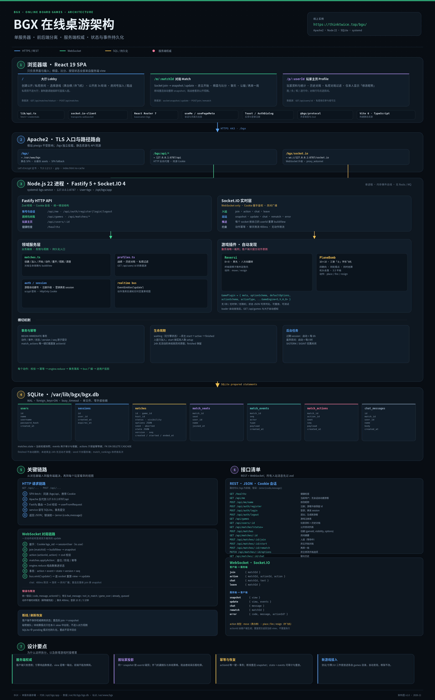

# BGX 架构全貌



> 高清矢量版：[bgx-architecture.svg](bgx-architecture.svg)  
> 生成脚本：`python3 scripts/make-architecture-diagram.py`（需要 `pillow` 与 `cairosvg`）

BGX 是一个**单服务器、前后端分离**的在线桌游站点。前端只负责界面与输入；房间、座位、回合、胜负、聊天、玩家资料全部由服务端计算并持久化。目前内置黑白棋与炸飞机；游戏是独立插件，服务端引擎与前端界面都按目录自动发现，框架不 import 任何具体棋种。

## 1. 一眼看全

```
浏览器 React SPA
   │  HTTPS 443  /bgx
   ▼
Apache2  ── /bgx/         →  /var/www/bgx（静态 SPA）
   │      ── /bgx/api/*    →  127.0.0.1:8787/api（HTTP 反代）
   │      ── /bgx/socket.io → 127.0.0.1:8787/socket.io（WebSocket 反代）
   ▼
Node.js 22 进程（systemd: bgx.service，User=bgx）
   ├─ Fastify 5 HTTP API      账号 / 房间 / 玩家主页 / 健康检查
   ├─ Socket.IO 4 实时层       join / action / chat / 快照与增量推送
   ├─ 领域服务                 matches / profiles / auth / session
   ├─ 游戏插件                 games/<id> 自动发现；Reversi / PlaneBomb
   └─ 后台任务                 过期 session 清理、废弃房间清理
   │
   ▼
SQLite  /var/lib/bgx/bgx.db（WAL）
   users · sessions · matches · match_seats
   match_events · match_actions · chat_messages
```

根站 piwigo 仍在同一台 Apache 上，BGX 只是按 `/bgx` 路径挂载，不改动根站配置。

## 2. 前端

前端是 React 19 + Vite 6 的 SPA，构建产物部署到 `/var/www/bgx`，`base=/bgx/`。

| 页面 | 路由 | 职责 |
| --- | --- | --- |
| 大厅 | `/` | 选择游戏、创建公开/私密房间、3 秒轮询公开房、房间号加入、观战 |
| 对局 | `/m/:matchId` | Socket join → snapshot/update、棋盘与比分、聊天、认输、再来一局、邀请链接 |
| 玩家主页 | `/p/:userId` | 玩家资料、胜/负/和统计、历史对局；私密局仅参与者可见；仅本人可改名 |

关键模块：

- `apps/web/src/lib/api.ts` — fetch 封装，统一 `credentials` 与错误结构
- `apps/web/src/lib/socket.ts` — Socket.IO 客户端，`transports:['websocket']`，`path=/bgx/socket.io`
- `apps/web/src/pages/MatchPage.tsx` — 连接、快照、动作、聊天、错误处理
- `apps/web/src/components/PlaneBombGame.tsx`、`Board.tsx` — 棋盘渲染
- `apps/web/src/hooks/usePageMeta.ts` — 页面标题与 description
- `apps/web/src/pages/ProfilePage.tsx` — 玩家资料与历史

前端**不保存权威棋局状态**：刷新或断线后重新 `join`，服务端返回当前 `snapshot`。棋盘、按钮是否可点、合法落点都由 `view` 决定。

## 3. 服务端

### 3.1 HTTP API（Fastify）

所有路径对外以 `/bgx` 为前缀，经 Apache 去掉前缀后转发到 8787。错误统一为：

```json
{ "error": { "code": "match_not_found", "message": "房间不存在" } }
```

| 方法 | 路径 | 说明 |
| --- | --- | --- |
| GET | `/healthz` | 健康检查 |
| GET | `/api/me` | 当前用户；没有会话时自动创建游客 |
| POST | `/api/me/name` | 修改昵称（游客也可用） |
| POST | `/api/auth/register` | 注册；游客升级为账号并保留 user id |
| POST | `/api/auth/login` | 登录；成功后换发新 session |
| POST | `/api/auth/logout` | 退出；删除旧 session，生成新游客 |
| GET | `/api/games` | 已注册游戏列表（registry 驱动） |
| GET | `/api/users/:id` | 玩家资料 + 历史对局（私密局按 viewer 过滤） |
| GET | `/api/matches?status=` | 公开房间列表（`waiting` / `active` / `all`） |
| POST | `/api/matches` | 创建房间，body `{ gameId, visibility, options? }` |
| GET | `/api/matches/:id` | 房间摘要 |
| POST | `/api/matches/:id/join` | 入座；只加入等待中的房间，不自动开战 |
| POST | `/api/matches/:id/start` | 房主开始对局；至少 `minPlayers` 人 |
| PATCH | `/api/matches/:id/options` | 房主在等待阶段修改开局选项 |
| POST | `/api/matches/:id/abort` | 房主中止进行中的对局（`aborted=true`，不计胜负） |
| POST | `/api/matches/:id/rematch` | 结束后复制座位创建新局（等待房主开始） |
| GET | `/api/matches/:id/chat` | 聊天历史 |

Cookie 为 `bgx_sid`：HttpOnly、`Path=/bgx`、SameSite=Lax，线上加 `Secure`。登录成功后换发 session，避免会话固定。

### 3.2 WebSocket（Socket.IO）

握手阶段复用同一个 Cookie：`io.use` 从 `Cookie` 头解析 `bgx_sid`，查 `sessions` → `users`，失败直接拒绝连接。

客户端 → 服务端：

| 消息 | 载荷 |
| --- | --- |
| `join` | `{ matchId }` |
| `action` | `{ matchId, actionId, action }` |
| `chat` | `{ matchId, text }` |
| `leave` | `{ matchId }` |

服务端 → 客户端：

| 消息 | 载荷 |
| --- | --- |
| `snapshot` | `{ view }` |
| `update` | `{ view, events }` |
| `chat` | `{ message }` |
| `rematch` | `{ matchId }` |
| `error` | `{ code, message, actionId? }` |

动作类型由游戏决定：黑白棋 `move` / `resign`；炸飞机 `place` / `fire` / `resign`。所有入站消息先过 Zod。

### 3.3 领域服务

- `matches.ts`
  - 创建、加入、入座、动作、认输、再来一局、公开房列表
  - `buildView(matchId, userId)`：按玩家投影视图（座位、是否观战、当前回合、合法点、炸飞机秘密信息）
  - `applyAction`：状态/座位校验 → 幂等检查 → `resignable` 检查 → `engine.reduce` → 事务落库（含 action payload）→ 事件总线
  - 房主 `abort`：`active` 时结束为 `finished`，`aborted=true`、`winner=null`
  - `deleteStaleMatches`：清理 24 小时无活动的未结束房间
- `games/loader.ts` + `games/<id>/engine.ts`
  - 启动时扫描 `games/<id>/index.ts|js`，动态注册 `plugin`
  - 纯函数引擎，不访问数据库/网络；随机只从注入的 `RandomSource` 取；状态可 JSON 序列化
  - `meta`、`actionSchema`、`actionType` 都由游戏模块自带
- `profiles.ts`
  - 联查 `matches JOIN match_seats`，计算胜/负/和/进行中
  - 私密房间只对本人或参与者可见
- `auth.ts` / `password.ts`
  - 游客自动建号；注册升级当前游客
  - scrypt N=16384, r=8, p=1，加盐哈希
  - session 存 SQLite，过期清理启动执行 + 每 6 小时
- `matches.ts`
  - 创建时生成 `seed`；`waiting` 阶段不调用 `setup`，`MatchView.game` 为 `null`
  - 房主 `start` 时按实际人数重新 `setup`，状态才变 `active`
  - 随机种子只存服务端，不下发客户端；rematch 生成新种子
- `realtime.ts`
  - `join` 后加入 `match:<id>` 房间并回 `snapshot`
  - 动作落库后监听 `bus.emit('update')`，对房间内每个 socket **用自己的 userId 重新 buildView**，再推送 `update`
  - 聊天 400ms 限流；动作不设时间限流，靠 `match_actions` 幂等

### 3.4 游戏引擎接口

```ts
interface GameEngine<S, V, A, O> {
  setup(playerCount: number, options: O, rng: RandomSource): S;
  reduce(state: S, seat: number, action: A, ctx: { now: number; rng: RandomSource }): ReduceResult<S>;
  resignable(state: S, seat: number): boolean;
  rankings?(state: S): Array<{ seat: number; rank: number; score?: number }>;
  view(state: S, viewerSeat: number | null, active: boolean): V;
  finished(state: S): boolean;
  winner(state: S): number | null;
  turn(state: S): number | null;
}

interface GamePlugin<S, V, A, O> extends GameEngine<S, V, A, O> {
  meta: GameCatalog;
  optionSchema: ZodType<O>;
  defaultOptions: O;
  actionSchema: ZodType<A>;
  actionType(action: A): string;
}
```

约定：

- `reduce` 只做纯状态转移，非法动作返回错误码
- `view` 是唯一输出，必须按 viewer 裁剪秘密信息
- `finished` / `winner` 决定 `matches.status` 与结果
- 炸飞机 `turn()` 恒为 `null`：没有先后手，靠 `phase + pendingShots` 判断

## 4. 数据模型

```sql
users(id, name, username, password_hash, created_at)
sessions(id, user_id, created_at, expires_at)
matches(id, game_id, host_id, status, visibility, options, seed, aborted, state,
        version, seq, created_at, started_at, ended_at)
match_seats(match_id, seat, user_id, name, joined_at)
match_events(match_id, seq, actor, type, payload, created_at)
match_actions(match_id, action_id, seat, seq, payload, created_at)
match_rankings(match_id, user_id, seat, rank, score, created_at)
chat_messages(id, match_id, user_id, name, body, created_at)
```

关键点：

- `matches.state` 是当前权威快照（JSON）；`waiting` 时是 `null`
- `matches.version` 每次动作 +1；`seq` 是对局内事件序号
- `match_actions` 的 `(match_id, action_id)` 主键用于幂等：重复提交直接返回当前 view
- `match_events` 记录引擎事件（`level` 区分 info/major），用于审计和增量；炸飞机的 `plane_placed` 事件不带坐标，事件日志不等于完整逐手回放
- `match_actions.payload` 保存动作原文，便于审计/调试；仍不等于完整隐藏信息回放
- `match_rankings` 保存终局名次（4 人局等）；`waiting` 不创建游戏状态
- 所有外键 `ON DELETE CASCADE`；清理未结束房间时座位、事件、动作、聊天一起删
- finished 对局不自动删除

事务：

```sql
BEGIN IMMEDIATE;
-- 写 match_actions / match_events
-- 更新 matches.state / version / seq / status / ended_at
COMMIT;
```

## 5. 一次动作的完整链路

以炸飞机开火为例：

1. 浏览器点击格子，生成 `actionId`，通过 Socket 发送 `action`
2. `realtime.ts` 用 Zod 校验消息，检查 socket 已经 `join` 该房间
3. `matches.applyAction` 校验阶段与座位；`match_actions` 查重
4. `engine.reduce` 纯函数推进状态：入队或同时结算两炮
5. 事务写入 action（含 payload）、events、新 state、version、seq；必要时写 `match_rankings` 并把 status 改为 finished
6. `bus.emit('update')`
7. `realtime.ts` 遍历房间内 socket，对每个 socket 用其 userId 调 `buildView`
8. 每个玩家收到属于自己的 `update`；前端按 `seq` 丢弃旧包

## 6. 部署与运维

| 项 | 值 |
| --- | --- |
| 站点 | `https://thinktwice.top/bgx/` |
| 静态文件 | `/var/www/bgx` |
| 应用代码 | `/opt/bgx/app` |
| 数据 | `/var/lib/bgx/bgx.db`（WAL） |
| 进程 | `systemd` 单元 `bgx.service`，User=bgx |
| 监听 | `127.0.0.1:8787` |
| 反向代理 | Apache2，`/bgx/api` 与 `/bgx/socket.io` |
| 部署脚本 | `bash scripts/deploy.sh` |

环境变量：`NODE_ENV=production`、`PORT=8787`、`HOST=127.0.0.1`、`DB_PATH=/var/lib/bgx/bgx.db`、`PUBLIC_BASE_PATH=/bgx`、`COOKIE_SECURE=1`。

后台任务：

- 过期 session：启动时 + 每 6 小时
- 废弃房间：启动时 + 每小时；只处理 `waiting` / `active` 且 24 小时无活动
- SIGTERM / SIGINT：关闭 HTTP、Socket.IO 与数据库

## 7. 边界与取舍

- **单进程**：Socket.IO 使用内存 adapter，事件总线是进程内 `EventEmitter`；不能直接多实例水平扩展
- **单写者**：SQLite 适合当前规模；高并发写需要换 PostgreSQL 或加队列
- **无 Redis / MQ / K8s**：第一版刻意不上，降低运维面
- **动作不设时间限流**：回合制 + `actionId` 幂等已经足够；滥用留给网关
- **没有自动备份**：数据库备份需要运维侧定时 `sqlite3 .backup` 或文件快照
- **事件日志不是完整回放**：炸飞机布阵事件不含坐标；完整状态在 `matches.state`

## 8. 新增一个游戏

1. `packages/protocol/src/games/<id>.ts`：catalog、视图类型、动作类型、Zod schema
2. `apps/server/src/games/<id>/`：纯函数 `engine.ts` + 导出 `plugin` 的 `index.ts`
3. `apps/web/src/games/<id>/`：导出 `GameUiPlugin` 的 `index.tsx` 与棋盘组件
4. 补引擎单测；`pnpm test && pnpm build && pnpm deploy`
5. 线上验证大厅、对局、观战、断线重连

不需要改 `MatchPage`、`Lobby`、`registry`、入口或协议核心。完整指南见
[docs/games/developing-games.md](../games/developing-games.md)。
